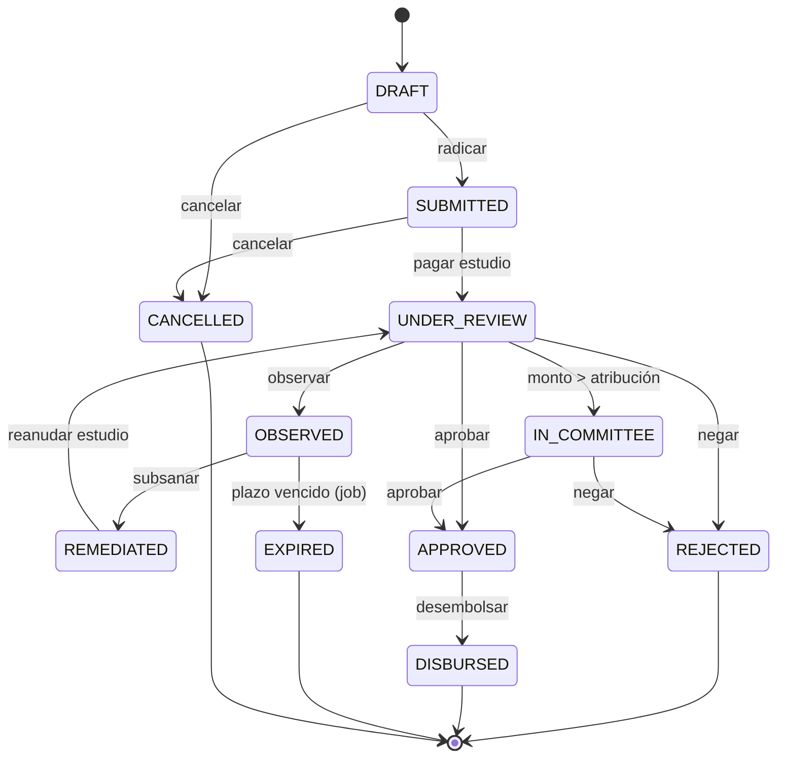
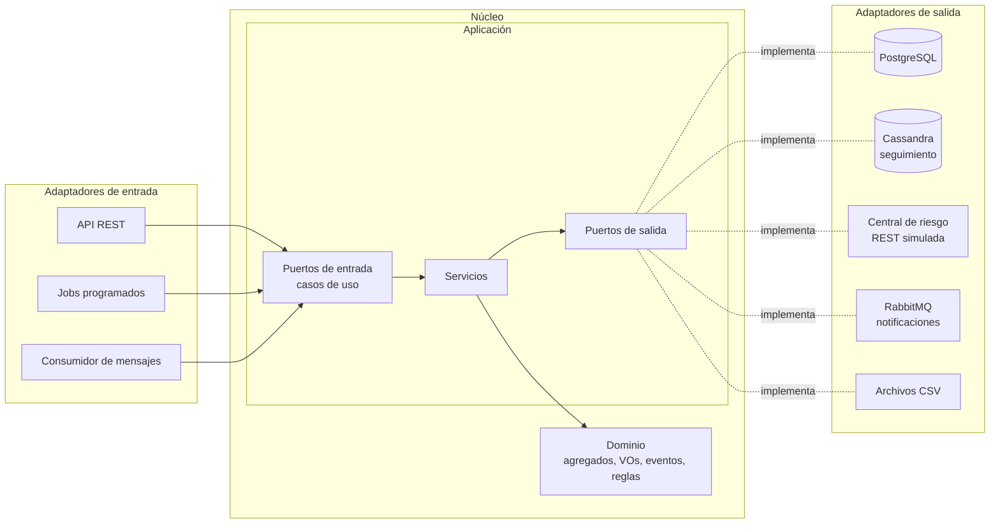

# Análisis inicial de requerimientos

## 1. Identificación del proyecto

**Nombre:** Loan Origination System
**Tipo:** Backend de originación de créditos de consumo (de la solicitud al desembolso)
**Arquitectura:** Hexagonal (Puertos y Adaptadores)
**Versión de alcance:** Inicial
**Estado:** Alcance base aprobado. Las decisiones tomadas y abiertas están en la sección 13; el plan de entregas, en `02-roadmap.md`.

## 2. Problema y objetivo

Una entidad financiera recibe solicitudes de crédito de sus clientes. Cada solicitud debe cumplir unos requisitos documentales y pasar por una evaluación de riesgo y de capacidad de pago antes de aprobarse o negarse. Hoy ese proceso se hace a mano: los documentos incompletos se devuelven sin un plazo claro, el cliente no sabe en qué va su trámite y la entidad no tiene indicadores de tiempos ni de aprobación.

El objetivo es construir una aplicación backend que gestione la originación del crédito de forma trazable: radicación, verificación de requisitos, evaluación, observaciones y subsanación, decisión, plan de pagos, desembolso, encuesta de satisfacción y estadísticas.

Las reglas del negocio deben quedar aisladas de la tecnología. El núcleo (dominio y casos de uso) debe poder ejecutarse y probarse sin base de datos, sin interfaz de usuario y sin servicios externos.

## 3. Alcance

### Incluido

- Registro y consulta de clientes (solicitantes).
- Catálogo de productos de crédito con su tasa, plazos, montos y requisitos.
- Creación, radicación y consulta de solicitudes de crédito.
- Carga y verificación de requisitos documentales por producto.
- Pago de la tarifa de estudio de crédito.
- Consulta de score en una central de riesgo externa (simulada).
- Evaluación de capacidad de pago y decisión automática o manual.
- Escalamiento a comité para montos altos.
- Observaciones del analista y subsanación por parte del cliente, con plazo.
- Vencimiento automático de solicitudes no subsanadas a tiempo.
- Generación del plan de pagos (tabla de amortización) al aprobar.
- Registro del desembolso.
- Seguimiento (historial de estados) de cada solicitud.
- Encuesta de satisfacción al cerrar el trámite.
- Estadísticas de la originación.
- Notificación al cliente de los cambios relevantes de su solicitud.

### Fuera de alcance

- Gestión de cartera: recaudo de cuotas, mora, refinanciación y castigo.
- Garantías, seguros y codeudores.
- Autenticación de usuarios. Los roles describen responsabilidades, no un login.
- Integración real con centrales de riesgo o con el core bancario.
- Frontend.

## 4. Actores

| Actor | Responsabilidad |
|---|---|
| Cliente (solicitante) | Registra sus datos, crea y radica la solicitud, carga requisitos, paga el estudio, subsana observaciones y responde la encuesta |
| Analista de crédito | Revisa requisitos, registra observaciones, evalúa y decide solicitudes dentro de su atribución |
| Comité de crédito | Decide las solicitudes que superan la atribución del analista |
| Administrador | Mantiene productos de crédito, tasas y requisitos; consulta estadísticas |
| Central de riesgo (sistema externo) | Devuelve el score crediticio del cliente |
| Sistema (jobs) | Vence solicitudes no subsanadas y procesa notificaciones |

## 5. Flujo principal

1. El cliente se registra con su documento, nombres, correo, teléfono e ingresos mensuales.
2. El cliente crea una solicitud en estado `DRAFT`, eligiendo producto, monto y plazo.
3. El cliente carga los requisitos que exige el producto y radica la solicitud. El sistema verifica que estén los obligatorios y la pasa a `SUBMITTED`.
4. El cliente paga la tarifa de estudio. Con el pago confirmado, la solicitud pasa a `UNDER_REVIEW`.
5. El sistema consulta el score del cliente en la central de riesgo, calcula la cuota y la capacidad de pago y emite una **recomendación automática** (`APPROVE` o `REJECT`, con sus motivos).
6. Si falta o es inválido algún documento, el analista registra una observación y la solicitud pasa a `OBSERVED`. El cliente tiene un plazo para subsanar; al hacerlo, pasa a `REMEDIATED` y vuelve a `UNDER_REVIEW`.
7. Si el plazo vence sin subsanar, un job pasa la solicitud a `EXPIRED`.
8. Si el monto supera la atribución del analista, la solicitud pasa a `IN_COMMITTEE`.
9. El analista o el comité deciden: `APPROVED` o `REJECTED` (con motivo). La recomendación automática orienta, pero la decisión final siempre es humana; si se aparta de la recomendación, debe justificarse.
10. Al aprobar, el sistema genera el plan de pagos.
11. Se registra el desembolso y la solicitud pasa a `DISBURSED`.
12. Al terminar en `DISBURSED`, `REJECTED` o `EXPIRED`, se envía la encuesta de satisfacción.
13. Cada cambio de estado queda en el seguimiento y genera un evento de dominio que dispara la notificación al cliente.

## 6. Requerimientos funcionales

| ID | Requerimiento | Prioridad |
|---|---|---|
| RF-01 | Registrar un cliente con documento, nombres, correo, teléfono e ingreso mensual | Must |
| RF-02 | Consultar un cliente por documento | Must |
| RF-03 | Mantener productos de crédito (tasa, plazo mínimo/máximo, monto mínimo/máximo, tarifa de estudio, requisitos) | Must |
| RF-04 | Crear una solicitud de crédito en borrador con producto, monto y plazo | Must |
| RF-05 | Generar un número de solicitud legible y único (`LOS-2026-000123`) | Must |
| RF-06 | Cargar requisitos documentales a una solicitud | Must |
| RF-07 | Radicar la solicitud verificando los requisitos obligatorios del producto | Must |
| RF-08 | Registrar el pago de la tarifa de estudio | Must |
| RF-09 | Consultar el score del cliente en la central de riesgo | Must |
| RF-10 | Calcular la cuota mensual y la capacidad de pago | Must |
| RF-10a | Emitir una recomendación automática (`APPROVE` / `REJECT`) con sus motivos a partir del score y la capacidad de pago | Must |
| RF-11 | Registrar observaciones sobre la solicitud | Must |
| RF-12 | Subsanar observaciones dentro del plazo | Must |
| RF-13 | Vencer automáticamente las solicitudes observadas sin subsanar | Must |
| RF-14 | Escalar a comité las solicitudes que superan la atribución del analista | Should |
| RF-15 | Aprobar o negar una solicitud (analista o comité), con motivo obligatorio al negar o al apartarse de la recomendación | Must |
| RF-16 | Generar el plan de pagos de una solicitud aprobada | Must |
| RF-17 | Registrar el desembolso de una solicitud aprobada | Must |
| RF-18 | Cancelar una solicitud por parte del cliente antes de la decisión | Should |
| RF-19 | Consultar el seguimiento (historial de estados) de una solicitud | Must |
| RF-20 | Notificar al cliente los cambios de estado relevantes | Should |
| RF-21 | Registrar la encuesta de satisfacción de una solicitud cerrada | Should |
| RF-22 | Consultar estadísticas: solicitudes por estado y producto, tasa de aprobación, monto promedio, tiempo promedio de respuesta, motivos de rechazo | Must |
| RF-23 | Cargar productos y tasas desde un archivo CSV | Could |
| RF-24 | Exportar estadísticas a CSV | Could |

### Estados de la solicitud

| Estado | Descripción |
|---|---|
| `DRAFT` | Borrador, editable por el cliente |
| `SUBMITTED` | Radicada, pendiente del pago del estudio |
| `UNDER_REVIEW` | En estudio por el analista |
| `OBSERVED` | Con observaciones pendientes de subsanar |
| `REMEDIATED` | Subsanada, vuelve a estudio |
| `IN_COMMITTEE` | En decisión del comité |
| `APPROVED` | Aprobada, pendiente de desembolso |
| `REJECTED` | Negada (terminal) |
| `DISBURSED` | Desembolsada (terminal) |
| `EXPIRED` | Vencida por no subsanar a tiempo (terminal) |
| `CANCELLED` | Cancelada por el cliente (terminal) |



Cualquier transición no dibujada debe ser rechazada por el dominio.

## 7. Requerimientos no funcionales

| ID | Requerimiento |
|---|---|
| RNF-01 | Arquitectura hexagonal: el dominio y los casos de uso no dependen de Spring, JPA ni de ninguna librería de infraestructura |
| RNF-02 | Las dependencias apuntan siempre hacia el dominio; la infraestructura implementa los puertos |
| RNF-03 | Los montos se manejan con `BigDecimal` y redondeo explícito (`HALF_EVEN`, 2 decimales); nunca `double` |
| RNF-04 | Los datos de entrada se validan en los Value Objects; un objeto del dominio no puede existir en estado inválido |
| RNF-05 | Los errores de negocio se expresan con excepciones de dominio y se traducen a respuestas HTTP en el adaptador REST |
| RNF-06 | El núcleo se prueba con adaptadores en memoria, sin base de datos ni servicios externos |
| RNF-07 | Cada adaptador de salida se puede reemplazar sin modificar el dominio ni los casos de uso |
| RNF-08 | La API REST está versionada (`/api/v1/...`) y documentada |
| RNF-09 | La aplicación y sus dependencias se levantan con Docker Compose |
| RNF-10 | Toda fecha se registra en UTC; los plazos se calculan en días calendario |

## 8. Modelo de dominio inicial

### Agregados

| Agregado | Responsabilidad |
|---|---|
| `Customer` | Datos del solicitante e ingreso mensual |
| `CreditProduct` | Condiciones del producto: tasa, plazos, montos, tarifa de estudio y requisitos |
| `LoanApplication` | Raíz principal. Controla estados, requisitos cargados, observaciones, evaluación, decisión, plan de pagos y desembolso |
| `Survey` | Respuesta de satisfacción asociada a una solicitud cerrada |

### Value Objects

| Value Object | Regla |
|---|---|
| `CustomerId`, `LoanApplicationId`, `CreditProductId` | Identificadores no nulos (UUID) |
| `DocumentNumber` | Tipo (CC, CE, PA) y número con formato válido |
| `FirstName`, `LastName` | No vacíos, longitud máxima |
| `Email`, `PhoneNumber` | Formato válido, normalizado |
| `Money` | Valor positivo con 2 decimales y moneda (COP) |
| `InterestRate` | Tasa efectiva anual mayor a 0; conversión a tasa mensual |
| `Term` | Plazo en meses dentro del rango del producto |
| `ApplicationNumber` | Formato `LOS-AAAA-NNNNNN` |
| `CreditScore` | Entero entre 0 y 1000 |
| `Observation` | Descripción, fecha y fecha límite de subsanación |
| `Installment` | Número, fecha, cuota, capital, interés y saldo |

### Eventos de dominio

`LoanApplicationSubmitted`, `LoanApplicationObserved`, `LoanApplicationRemediated`, `LoanApplicationApproved`, `LoanApplicationRejected`, `LoanApplicationDisbursed`, `LoanApplicationExpired`.

## 9. Reglas de negocio iniciales

| ID | Regla |
|---|---|
| RN-01 | El monto y el plazo deben estar dentro de los límites del producto |
| RN-02 | Solo se puede radicar si están cargados todos los requisitos obligatorios del producto |
| RN-03 | La solicitud pasa a estudio solo con el pago de la tarifa de estudio confirmado |
| RN-04 | La cuota mensual se calcula con el sistema de amortización francés (cuota fija) usando la tasa mensual equivalente a la efectiva anual |
| RN-05 | Capacidad de pago: la cuota no puede superar el 40% del ingreso mensual del cliente |
| RN-06 | La recomendación automática es `APPROVE` solo si el score es mayor o igual a 500 **y** se cumple RN-05; en otro caso es `REJECT`, con cada motivo incumplido ("score insuficiente", "capacidad de pago insuficiente") |
| RN-07 | Montos superiores a 50.000.000 COP requieren decisión del comité |
| RN-08 | El plazo para subsanar es de 5 días calendario desde la observación |
| RN-09 | Negar una solicitud exige un motivo |
| RN-09a | La decisión final siempre la toma el analista o el comité; si es distinta de la recomendación automática, la justificación es obligatoria |
| RN-10 | Solo se desembolsa una solicitud `APPROVED`, por el monto aprobado |
| RN-11 | El cliente solo puede cancelar en `DRAFT` o `SUBMITTED` |
| RN-12 | Un cliente no puede tener más de una solicitud abierta (no terminal) del mismo producto |
| RN-13 | La encuesta solo se registra una vez y solo para solicitudes en estado terminal; la calificación va de 1 a 5 |

Los valores de RN-05, RN-06, RN-07 y RN-08 son parámetros configurables.

## 10. Arquitectura

### Vista hexagonal



### Estructura de paquetes

Paquete base: `com.co.bank.credit.loan_origination_system`

El código se organiza **por módulo de negocio** y, dentro de cada módulo, por capa hexagonal (`domain`, `application`, `infrastructure`). Lo que comparten todos los módulos vive en `shared`.

```text
loan_origination_system/
├── loanapplication/                Solicitud de crédito (módulo central)
│   ├── domain/                     LoanApplication, estados, CreditPolicy, Observation...
│   │   ├── amortization/           Cuota fija y plan de pagos
│   │   └── event/                  Eventos de dominio de la solicitud
│   ├── application/
│   │   ├── port/in/                Casos de uso + Commands/Queries
│   │   ├── port/out/               Contratos hacia la infraestructura
│   │   └── service/                Implementación de los casos de uso
│   └── infrastructure/
│       ├── config/                 Beans de Spring que crean los servicios
│       ├── in/rest/                Controllers y DTOs
│       ├── in/scheduler/           Job de vencimiento de solicitudes
│       ├── out/persistence/        PostgreSQL con Spring Data JPA
│       ├── out/riskbureau/         Cliente REST de la central de riesgo
│       ├── out/tracking/           Seguimiento en Cassandra
│       └── out/messaging/          Publicador RabbitMQ
├── customer/                       Cliente: domain, application, infrastructure
├── creditproduct/                  Producto de crédito: domain, application, infrastructure
├── survey/                         Encuesta de satisfacción: domain, application, infrastructure
├── statistics/                     Estadísticas (solo lectura) y exportación CSV
└── shared/
    ├── domain/
    │   ├── kernel/                 AggregateRoot, DomainEvent
    │   ├── model/                  VOs compartidos (Money, Email, DocumentNumber...)
    │   ├── utils/                  Validaciones reutilizables (Validate)
    │   └── exception/              DomainException, BusinessRuleException...
    ├── application/
    │   ├── exception/              Excepciones de aplicación (no encontrado, etc.)
    │   └── port/out/               PublishDomainEventsPort
    └── infrastructure/             Configuración y piezas técnicas comunes
```

Las pruebas replican la misma estructura en `src/test/java`.

### Convenciones

- Entidades con fábrica `create(...)` para nuevas instancias y `reconstitute(...)` para reconstruirlas desde persistencia.
- Value Objects inmutables con fábrica `of(...)` que valida al construir.
- Enum de estado con `transitionTo(...)` que valida las transiciones permitidas.
- Un puerto de entrada por caso de uso (`@FunctionalInterface`), con `Command` para escrituras y `Query` para lecturas, ambos como `record`.
- Puertos de salida separados por intención: `XxxCommandPort` trabaja con el agregado (buscar para modificar, guardar) y `XxxQueryPort` devuelve proyecciones de solo lectura.
- Los servicios publican los eventos del agregado con `PublishDomainEventsPort` después de guardarlo.
- Los servicios de aplicación no tienen anotaciones de Spring: se crean como `@Bean` en el `XxxConfig` de la infraestructura de cada módulo.
- El dominio y la aplicación no tienen anotaciones de Spring ni de JPA; las entidades JPA viven en el adaptador y se mapean al dominio.
- Un módulo puede usar los identificadores y VOs del dominio de otro (por ejemplo, `LoanApplication` referencia `CustomerId`), pero nunca su infraestructura.

## 11. Stack propuesto

| Componente | Tecnología |
|---|---|
| Lenguaje | Java 25 |
| Framework | Spring Boot 4 (Web, Data JPA, Validation, AMQP) |
| Build | Maven |
| Base relacional | PostgreSQL |
| Base NoSQL | Cassandra |
| Mensajería | RabbitMQ |
| Pruebas | JUnit 5, AssertJ, Mockito, Spring Boot Test y ArchUnit (reglas de arquitectura) |
| Documentación API | OpenAPI (Swagger) y colección Postman |
| Contenedores | Docker y Docker Compose |

## 12. Criterios de aceptación del primer flujo vertical

1. Se puede registrar un cliente y crear una solicitud en borrador para un producto existente.
2. Radicar sin requisitos obligatorios devuelve un error de negocio y la solicitud sigue en `DRAFT`.
3. Con requisitos completos la solicitud pasa a `SUBMITTED`, y con el pago confirmado, a `UNDER_REVIEW`.
4. Una solicitud con score menor a 500 recibe la recomendación `REJECT` con el motivo "score insuficiente".
5. Una solicitud con cuota mayor al 40% del ingreso recibe la recomendación `REJECT` con el motivo "capacidad de pago insuficiente".
5a. Aprobar una solicitud con recomendación `REJECT` sin justificación devuelve un error de negocio.
6. Una solicitud aprobada tiene un plan de pagos cuya suma de capital es igual al monto aprobado.
7. Toda transición no permitida devuelve un error de negocio.
8. El seguimiento de la solicitud muestra cada cambio de estado con su fecha.
9. El flujo completo funciona con adaptadores en memoria, sin base de datos.

## 13. Supuestos y decisiones abiertas

**Supuestos**

- Moneda única: pesos colombianos (COP).
- La central de riesgo es un servicio simulado que devuelve un score según el número de documento.
- El pago de la tarifa de estudio se registra como confirmado; no se integra una pasarela real.
- El actor de cada operación se envía en el header opcional `X-User-Id`; si no llega, se registra `SYSTEM`.

**Decisiones tomadas**

| Fecha | Decisión |
|---|---|
| 2026-11-24 | Productos iniciales: *Libre inversión* (12 a 60 meses) y *Vehículo* (12 a 72 meses, exige cotización del vehículo) |
| 2026-11-24 | La evaluación automática emite una recomendación; la decisión final siempre es del analista o del comité (RN-06, RN-09a) |
| 2026-11-24 | Umbrales iniciales: capacidad 40%, score mínimo 500, comité desde 50.000.000 COP, subsanación en 5 días (configurables) |

**Decisiones abiertas**

- Atribución del analista por producto o única para todos.
- Alcance final de Cassandra y RabbitMQ.
